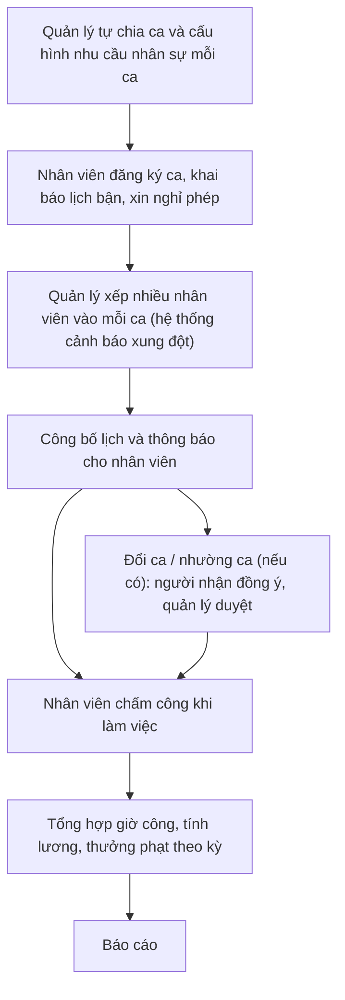

# TÀI LIỆU YÊU CẦU NGHIỆP VỤ (BRD)

## Business Requirements Document

### Dự án: Hệ thống quản lý nhân sự và xếp ca làm cho quán cafe

- **Phiên bản:** v1.1 | **Ngày ban hành:** 09/11/2026

---

## 1. TỔNG QUAN DỰ ÁN & MỤC TIÊU

### 1.1. Bối cảnh dự án

Dự án xây dựng hệ thống quản lý quán cafe, tập trung vào **quản lý nhân sự và sắp xếp ca làm của nhân viên**. Phần xử lý order (bán hàng) được loại khỏi phạm vi do mức độ phức tạp.

### 1.2. Mục tiêu dự án

Hệ thống hướng tới các mục tiêu nghiệp vụ sau:

1. **G1 - Quản lý nhân viên:** Quản lý tập trung hồ sơ, vị trí, hợp đồng, mức lương và trạng thái của nhân viên.
2. **G2 - Xếp ca:** Cho phép quản lý tự chia ca theo mong muốn và xếp nhiều nhân viên vào cùng một ca, dựa trên nhu cầu nhân sự từng ca, đăng ký của nhân viên và các quy tắc xếp ca, có cảnh báo xung đột.
3. **G3 - Theo dõi công:** Ghi nhận chấm công, xử lý đổi ca, nghỉ phép.
4. **G4 - Tính lương:** Tổng hợp giờ công và tính lương, thưởng phạt theo kỳ.
5. **G5 - Báo cáo:** Cung cấp báo cáo giờ làm, chi phí nhân công và tình trạng thiếu người theo ca.

---

## 2. CÁC BÊN LIÊN QUAN (STAKEHOLDERS)

| Vai trò | Nhu cầu nghiệp vụ cốt lõi |
|:--|:--|
| **Chủ quán** | Xem báo cáo giờ làm và chi phí nhân công; phân quyền người dùng; theo dõi nhật ký thao tác. |
| **Quản lý quán** | Quản lý hồ sơ nhân viên; tự chia ca và cấu hình ca; xếp nhiều nhân viên vào mỗi ca và công bố lịch; duyệt đổi ca; xử lý chấm công; tổng hợp lương. |
| **Nhân viên** | Đăng ký ca, khai báo lịch bận, xin nghỉ phép; xem lịch làm; đề nghị đổi/nhường ca; chấm công; nhận thông báo; xem phiếu lương của mình. |

Các vị trí công việc của nhân viên: pha chế, thu ngân, phục vụ, bếp, quản lý.

---

## 3. PHẠM VI DỰ ÁN (PROJECT SCOPE)

### 3.1. Trong phạm vi (In-Scope)

- Quản lý nhân viên
- Cấu hình ca làm (quản lý tự chia ca theo mong muốn)
- Đăng ký ca và khả năng làm việc
- Xếp ca (một ca có nhiều nhân viên)
- Đổi ca và nhường ca
- Chấm công
- Tính lương và thưởng phạt
- Thông báo
- Báo cáo
- Phân quyền và hệ thống (vai trò, nhật ký thao tác)

### 3.2. Ngoài phạm vi (Out-of-Scope)

- Xử lý order / bán hàng (POS): được loại bỏ khỏi dự án.
- Các nhóm chức năng không thuộc quản lý nhân sự và xếp ca (quản lý bàn, thực đơn, màn hình bar/bếp, kho, khách hàng, thu chi tài chính, khách tự đặt món).
- Quản lý đa chi nhánh: để giai đoạn sau.

---

## 4. QUY TRÌNH NGHIỆP VỤ MỤC TIÊU (TO-BE)

---

## 5. YÊU CẦU NGHIỆP VỤ CHI TIẾT (BUSINESS REQUIREMENTS)

### 5.1. Nhóm BR-01: Quản lý nhân viên

- **BR-01.1:** Lưu hồ sơ nhân viên gồm thông tin cá nhân, thông tin liên hệ và loại hợp đồng (full-time / part-time / thời vụ).
- **BR-01.2:** Gán vị trí cho nhân viên: pha chế, thu ngân, phục vụ, bếp, quản lý.
- **BR-01.3:** Lưu mức lương (theo giờ hoặc theo ca) và trạng thái nhân viên (đang làm / nghỉ việc).

### 5.2. Nhóm BR-02: Cấu hình ca làm

- **BR-02.1:** Quản lý tự định nghĩa và chia ca theo mong muốn: số lượng ca, tên ca, giờ bắt đầu và giờ kết thúc do quản lý đặt, không cố định sẵn (ví dụ: chia thành ca sáng, chiều, tối, hoặc chia theo cách khác).
- **BR-02.2:** Mỗi ca có thể có nhiều nhân viên. Quản lý khai báo nhu cầu nhân sự cho mỗi ca: số lượng nhân viên cần và, nếu muốn, số lượng theo từng vị trí (ví dụ: một ca cần 1 pha chế + 2 phục vụ).
- **BR-02.3:** Cho phép cấu hình khác nhau cho ngày thường, cuối tuần và ngày lễ.

### 5.3. Nhóm BR-03: Đăng ký ca và khả năng làm việc

- **BR-03.1:** Nhân viên đăng ký các ca muốn làm trong tuần/tháng tới. Nhiều nhân viên có thể đăng ký cùng một ca.
- **BR-03.2:** Nhân viên khai báo lịch bận cố định (ví dụ: bận học vào một số buổi cố định trong tuần).
- **BR-03.3:** Nhân viên gửi yêu cầu xin nghỉ phép.

### 5.4. Nhóm BR-04: Xếp ca

- **BR-04.1:** Quản lý xếp ca thủ công trên giao diện lịch (kéo thả), có thể xếp nhiều nhân viên vào cùng một ca.
- **BR-04.2:** Hệ thống gợi ý hoặc tự động xếp ca dựa trên đăng ký của nhân viên, nhu cầu nhân sự của ca và các quy tắc xếp ca.
- **BR-04.3:** Hệ thống cảnh báo xung đột: trùng ca (một nhân viên bị xếp vào các ca trùng giờ), thiếu người so với nhu cầu của ca, vượt giờ làm tối đa, thiếu vị trí cần thiết.
- **BR-04.4:** Quản lý công bố lịch và hệ thống thông báo cho nhân viên.

### 5.5. Nhóm BR-05: Đổi ca và nhường ca

- **BR-05.1:** Nhân viên đề nghị đổi ca hoặc nhờ người khác làm thay.
- **BR-05.2:** Người nhận đồng ý, quản lý duyệt.
- **BR-05.3:** Lưu lịch sử thay đổi ca.

### 5.6. Nhóm BR-06: Chấm công

- **BR-06.1:** Nhân viên check-in / check-out (qua app, QR tại quán hoặc GPS; phương thức cụ thể chưa chốt).
- **BR-06.2:** Xử lý các trường hợp đi trễ, về sớm, quên chấm công.
- **BR-06.3:** Quản lý được chỉnh sửa công, hệ thống ghi lại lý do chỉnh sửa.

### 5.7. Nhóm BR-07: Tính lương và thưởng phạt

- **BR-07.1:** Tổng hợp giờ công theo kỳ.
- **BR-07.2:** Ghi nhận phụ cấp, thưởng, phạt, tăng ca và hệ số ngày lễ.
- **BR-07.3:** Tạo phiếu lương cho từng nhân viên và xuất ra Excel.

### 5.8. Nhóm BR-08: Thông báo

- **BR-08.1:** Nhắc ca sắp tới.
- **BR-08.2:** Thông báo khi có lịch mới.
- **BR-08.3:** Thông báo kết quả duyệt đổi ca và nghỉ phép.
- **BR-08.4:** Kênh thông báo có thể là push, Zalo hoặc Telegram bot (chưa chốt).

### 5.9. Nhóm BR-09: Báo cáo

- **BR-09.1:** Tổng giờ làm theo nhân viên.
- **BR-09.2:** Tỷ lệ đi trễ / vắng.
- **BR-09.3:** Chi phí nhân công theo tuần/tháng.
- **BR-09.4:** Ca nào thường thiếu người.

### 5.10. Nhóm BR-10: Phân quyền và hệ thống

- **BR-10.1:** Phân quyền theo vai trò: chủ quán, quản lý, nhân viên.
- **BR-10.2:** Nhật ký thao tác: ghi lại ai sửa lịch, ai sửa công.
- **BR-10.3:** Quản lý đa chi nhánh (để giai đoạn sau).

---

## 6. QUY TẮC NGHIỆP VỤ (BUSINESS RULES)

- **BR-RULE-01 (Ca làm):** Ca do quản lý tự chia theo mong muốn; mỗi ca có thể gán cho nhiều nhân viên.
- **BR-RULE-02 (Quy tắc xếp ca):** Hệ thống cần hỗ trợ các nhóm quy tắc sau: số giờ làm tối đa mỗi tuần; thời gian nghỉ tối thiểu giữa 2 ca; số người cần cho mỗi ca (tổng và theo từng vị trí); ca mà nhân viên part-time được phép làm. Giá trị cụ thể của từng quy tắc chưa được xác định.
- **BR-RULE-03 (Đổi ca):** Một yêu cầu đổi ca chỉ hoàn tất khi người nhận đồng ý và quản lý duyệt; mọi thay đổi được lưu lịch sử.
- **BR-RULE-04 (Chỉnh sửa công):** Mọi chỉnh sửa công phải kèm lý do.
- **BR-RULE-05 (Truy vết):** Các thao tác sửa lịch và sửa công phải được ghi vào nhật ký thao tác.

---

## 7. YÊU CẦU PHI CHỨC NĂNG (NON-FUNCTIONAL REQUIREMENTS)

- **NFR-01 (Phân quyền truy cập):** Quyền sử dụng chức năng phân theo vai trò chủ quán, quản lý và nhân viên.
- **NFR-02 (Truy vết):** Hệ thống lưu nhật ký thao tác đối với việc sửa lịch và sửa công.

---

## 8. PHÂN KỲ TRIỂN KHAI

| Giai đoạn | Chức năng |
|:--|:--|
| **MVP** | Hồ sơ nhân viên; cấu hình ca (tự chia ca, nhiều nhân viên mỗi ca); đăng ký ca; xếp ca thủ công có cảnh báo xung đột; công bố lịch; phân quyền cơ bản. |
| **Giai đoạn 2** | Đổi ca; nghỉ phép; chấm công; thông báo qua Telegram/Zalo. |
| **Giai đoạn 3** | Tính lương; báo cáo; tự động gợi ý xếp ca. |
| **Để sau** | Quản lý đa chi nhánh. |
| **Chưa xếp giai đoạn** | Khai báo lịch bận cố định; nhật ký thao tác. |

---

## 9. TIÊU CHÍ NGHIỆM THU NGHIỆP VỤ (MVP)

1. **AC-1:** Quản lý tạo được hồ sơ nhân viên với đầy đủ loại hợp đồng, vị trí, mức lương và trạng thái.
2. **AC-2:** Quản lý tự tạo và chia được các ca theo mong muốn (tên ca, giờ bắt đầu, giờ kết thúc), khai báo được nhu cầu nhân sự mỗi ca, kể cả cấu hình khác nhau cho ngày thường, cuối tuần, ngày lễ.
3. **AC-3:** Nhân viên đăng ký được ca muốn làm.
4. **AC-4:** Quản lý xếp được nhiều nhân viên vào cùng một ca trên giao diện lịch và hệ thống cảnh báo khi trùng ca, thiếu người, vượt giờ tối đa hoặc thiếu vị trí cần thiết.
5. **AC-5:** Quản lý công bố được lịch và nhân viên xem được lịch của mình.
6. **AC-6:** Người dùng chỉ truy cập được chức năng thuộc vai trò của mình.
