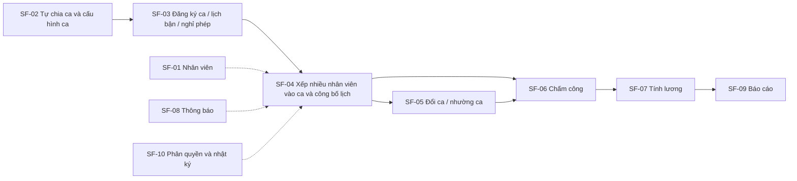
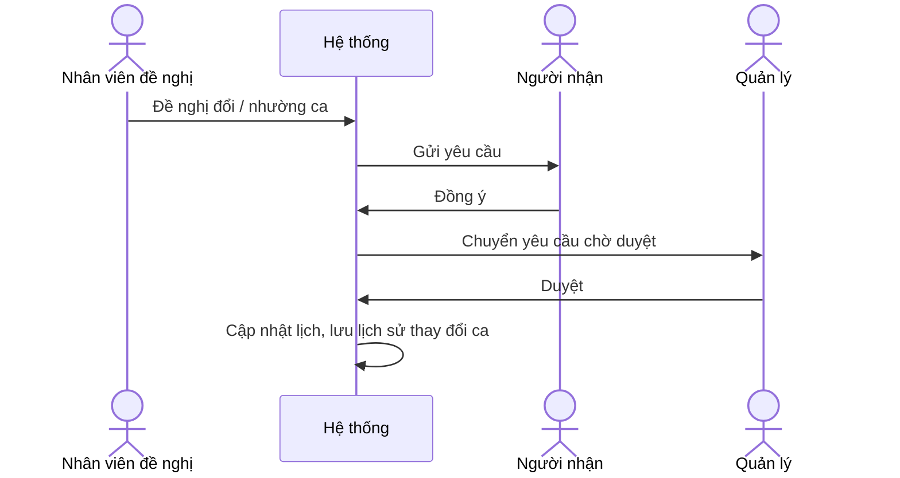
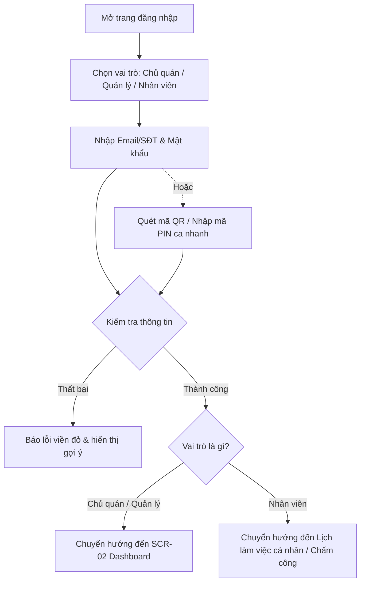
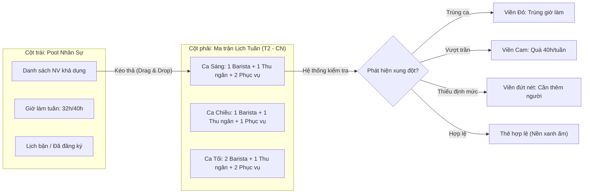

# ĐẶC TẢ YÊU CẦU PHẦN MỀM (SRS)

## Software Requirements Specification

### Hệ thống: Quản lý nhân sự và xếp ca làm cho quán cafe

- **Phiên bản:** v1.2 (Bổ sung đặc tả thiết kế Stitch UI/UX) | **Ngày cập nhật:** 09/11/2026
- **Tài liệu tham chiếu:** 02_Tai_lieu_Yeu_cau_Nghiep_vu_BRD.md

---

## 1. GIỚI THIỆU (INTRODUCTION)

### 1.1. Mục đích tài liệu

Tài liệu SRS chi tiết hóa các yêu cầu nghiệp vụ trong BRD thành các đặc tả chức năng phần mềm cho hệ thống quản lý nhân sự và xếp ca của quán cafe.

### 1.2. Phạm vi phần mềm

Hệ thống gồm 10 phân hệ:

1. SF-01: Quản lý nhân viên
2. SF-02: Cấu hình ca làm
3. SF-03: Đăng ký ca và khả năng làm việc
4. SF-04: Xếp ca
5. SF-05: Đổi ca và nhường ca
6. SF-06: Chấm công
7. SF-07: Tính lương và thưởng phạt
8. SF-08: Thông báo
9. SF-09: Báo cáo
10. SF-10: Phân quyền và hệ thống

Phần xử lý order (bán hàng) không thuộc phạm vi.

### 1.3. Định nghĩa

- **Ca làm:** Khoảng thời gian làm việc trong ngày do quản lý tự chia theo mong muốn, có giờ bắt đầu và giờ kết thúc. Một ca có thể có nhiều nhân viên cùng làm.
- **Vị trí:** Công việc của nhân viên trong quán: pha chế, thu ngân, phục vụ, bếp, quản lý.
- **Xếp ca:** Phân công nhân viên vào các ca làm.
- **Công bố lịch:** Bước quản lý chốt và gửi lịch làm cho nhân viên.
- **Đổi ca / nhường ca:** Nhân viên chuyển ca của mình cho người khác hoặc đổi với người khác.
- **MVP:** Phiên bản đầu tiên gồm các chức năng cốt lõi (xem mục 7).

---

## 2. MÔ TẢ TỔNG QUAN HỆ THỐNG

### 2.1. Các vai trò người dùng

- **Chủ quán:** Xem báo cáo giờ làm và chi phí nhân công, phân quyền, xem nhật ký thao tác.
- **Quản lý quán:** Quản lý hồ sơ nhân viên, tự chia ca và cấu hình ca, xếp nhiều nhân viên vào mỗi ca và công bố lịch, duyệt đổi ca, xử lý và chỉnh sửa chấm công, tổng hợp lương.
- **Nhân viên:** Đăng ký ca, khai báo lịch bận, xin nghỉ phép, xem lịch làm, đề nghị đổi/nhường ca, chấm công, nhận thông báo, xem phiếu lương của mình.

### 2.2. Luồng tổng thể



---

## 3. ĐẶC TẢ YÊU CẦU CHỨC NĂNG (FUNCTIONAL REQUIREMENTS)

### 3.1. Phân hệ SF-01: Quản lý nhân viên

- **SF-01.1:** Hệ thống cho phép tạo, xem và cập nhật hồ sơ nhân viên gồm thông tin cá nhân và thông tin liên hệ.
- **SF-01.2:** Hệ thống cho phép chọn loại hợp đồng của nhân viên: full-time, part-time hoặc thời vụ.
- **SF-01.3:** Hệ thống cho phép gán vị trí cho nhân viên: pha chế, thu ngân, phục vụ, bếp, quản lý.
- **SF-01.4:** Hệ thống cho phép lưu mức lương của nhân viên theo giờ hoặc theo ca.
- **SF-01.5:** Hệ thống lưu trạng thái nhân viên: đang làm hoặc nghỉ việc.

### 3.2. Phân hệ SF-02: Cấu hình ca làm

- **SF-02.1:** Hệ thống cho phép quản lý tự tạo, sửa và xóa ca làm theo mong muốn: số lượng ca, tên ca, giờ bắt đầu và giờ kết thúc không bị cố định sẵn (ví dụ: chia thành ca sáng, chiều, tối, hoặc chia theo cách khác).
- **SF-02.2:** Hệ thống cho phép khai báo nhu cầu nhân sự của mỗi ca: một ca có thể có nhiều nhân viên; quản lý khai báo số lượng nhân viên cần và, nếu muốn, số lượng theo từng vị trí (ví dụ: một ca cần 1 pha chế + 2 phục vụ).
- **SF-02.3:** Hệ thống cho phép cấu hình ca và nhu cầu nhân sự khác nhau cho ngày thường, cuối tuần và ngày lễ.

### 3.3. Phân hệ SF-03: Đăng ký ca và khả năng làm việc

- **SF-03.1:** Hệ thống cho phép nhân viên đăng ký các ca muốn làm trong tuần/tháng tới. Nhiều nhân viên có thể đăng ký cùng một ca.
- **SF-03.2:** Hệ thống cho phép nhân viên khai báo lịch bận cố định (ví dụ: bận học vào một số buổi cố định trong tuần).
- **SF-03.3:** Hệ thống cho phép nhân viên gửi yêu cầu xin nghỉ phép.

### 3.4. Phân hệ SF-04: Xếp ca

- **SF-04.1:** Hệ thống cung cấp giao diện lịch để quản lý xếp ca thủ công bằng thao tác kéo thả; có thể xếp nhiều nhân viên vào cùng một ca.
- **SF-04.2:** Hệ thống gợi ý hoặc tự động xếp ca dựa trên đăng ký của nhân viên, nhu cầu nhân sự của ca và các quy tắc xếp ca.
- **SF-04.3:** Hệ thống cảnh báo các xung đột khi xếp ca:
  - Trùng ca (một nhân viên bị xếp vào các ca trùng giờ)
  - Thiếu người so với nhu cầu của ca
  - Vượt giờ làm tối đa
  - Thiếu vị trí cần thiết
- **SF-04.4:** Hệ thống cho phép quản lý công bố lịch và gửi thông báo cho nhân viên.
- **SF-04.5:** Hệ thống hỗ trợ các nhóm quy tắc xếp ca: số giờ làm tối đa mỗi tuần; thời gian nghỉ tối thiểu giữa 2 ca; số người cần cho mỗi ca (tổng và theo từng vị trí); ca mà nhân viên part-time được phép làm. Giá trị cụ thể của từng quy tắc chưa được xác định.

### 3.5. Phân hệ SF-05: Đổi ca và nhường ca

- **SF-05.1:** Hệ thống cho phép nhân viên đề nghị đổi ca hoặc nhờ người khác làm thay.
- **SF-05.2:** Hệ thống cho phép người nhận đồng ý yêu cầu, sau đó quản lý duyệt.
- **SF-05.3:** Hệ thống lưu lịch sử thay đổi ca.



### 3.6. Phân hệ SF-06: Chấm công

- **SF-06.1:** Hệ thống cho phép nhân viên check-in và check-out (qua app, QR tại quán hoặc GPS; phương thức cụ thể chưa chốt).
- **SF-06.2:** Hệ thống xử lý các trường hợp đi trễ, về sớm và quên chấm công.
- **SF-06.3:** Hệ thống cho phép quản lý chỉnh sửa công và ghi lại lý do chỉnh sửa.

### 3.7. Phân hệ SF-07: Tính lương và thưởng phạt

- **SF-07.1:** Hệ thống tổng hợp giờ công theo kỳ.
- **SF-07.2:** Hệ thống ghi nhận phụ cấp, thưởng, phạt, tăng ca và hệ số ngày lễ.
- **SF-07.3:** Hệ thống tạo phiếu lương cho từng nhân viên.
- **SF-07.4:** Hệ thống cho phép xuất dữ liệu lương ra Excel.

### 3.8. Phân hệ SF-08: Thông báo

- **SF-08.1:** Hệ thống nhắc ca sắp tới.
- **SF-08.2:** Hệ thống thông báo khi có lịch mới.
- **SF-08.3:** Hệ thống thông báo kết quả duyệt đổi ca và nghỉ phép.
- **SF-08.4:** Kênh thông báo có thể là push, Zalo hoặc Telegram bot (chưa chốt).

### 3.9. Phân hệ SF-09: Báo cáo

- **SF-09.1:** Báo cáo tổng giờ làm theo nhân viên.
- **SF-09.2:** Báo cáo tỷ lệ đi trễ / vắng.
- **SF-09.3:** Báo cáo chi phí nhân công theo tuần/tháng.
- **SF-09.4:** Báo cáo ca thường thiếu người.

### 3.10. Phân hệ SF-10: Phân quyền và hệ thống

- **SF-10.1:** Hệ thống phân quyền theo vai trò: chủ quán, quản lý, nhân viên.
- **SF-10.2:** Hệ thống ghi nhật ký thao tác: ai sửa lịch, ai sửa công.
- **SF-10.3:** Hỗ trợ đa chi nhánh (để giai đoạn sau).

---

## 4. MÔ HÌNH DỮ LIỆU KHÁI NIỆM

Các nhóm dữ liệu chính suy ra từ các chức năng ở mục 3. Thuộc tính chi tiết sẽ được xác định ở bước thiết kế.

| Nhóm dữ liệu | Nội dung lưu trữ |
|:--|:--|
| Nhân viên | Thông tin cá nhân, thông tin liên hệ, loại hợp đồng, vị trí, mức lương (theo giờ hoặc theo ca), trạng thái (đang làm / nghỉ việc) |
| Định nghĩa ca | Tên ca, giờ bắt đầu, giờ kết thúc (do quản lý tự đặt), số nhân viên cần (tổng và theo vị trí), cấu hình cho ngày thường / cuối tuần / ngày lễ |
| Đăng ký ca và khả năng làm việc | Ca nhân viên muốn làm, lịch bận cố định, yêu cầu nghỉ phép |
| Lịch làm | Phân công nhân viên vào ca (một ca gồm nhiều nhân viên), trạng thái công bố |
| Yêu cầu đổi / nhường ca | Người đề nghị, người nhận, kết quả đồng ý, kết quả duyệt, lịch sử thay đổi |
| Chấm công | Check-in, check-out, đi trễ, về sớm, quên chấm công, lý do chỉnh sửa |
| Lương | Giờ công theo kỳ, phụ cấp, thưởng, phạt, tăng ca, hệ số ngày lễ, phiếu lương |
| Thông báo | Nhắc ca, lịch mới, kết quả duyệt đổi ca và nghỉ phép |
| Nhật ký thao tác | Người sửa lịch, người sửa công |
| Người dùng và vai trò | Vai trò: chủ quán, quản lý, nhân viên |

---

## 5. YÊU CẦU PHI CHỨC NĂNG (NON-FUNCTIONAL REQUIREMENTS)

- **NFR-01 (Phân quyền truy cập):** Quyền sử dụng chức năng được phân theo vai trò chủ quán, quản lý và nhân viên (SF-10.1).
- **NFR-02 (Truy vết):** Hệ thống lưu nhật ký thao tác đối với việc sửa lịch và sửa công (SF-10.2).

---

## 6. MA TRẬN TRUY XUẤT YÊU CẦU (RTM)

| Yêu cầu nghiệp vụ (BRD) | Chức năng phần mềm (SRS) | Giai đoạn |
|:--|:--|:--|
| BR-01 Quản lý nhân viên | SF-01 | MVP |
| BR-02 Cấu hình ca làm (tự chia ca, nhiều nhân viên mỗi ca) | SF-02 | MVP |
| BR-03 Đăng ký ca và khả năng làm việc | SF-03.1 | MVP |
| BR-03 (lịch bận cố định) | SF-03.2 | Chưa xếp giai đoạn |
| BR-03 (nghỉ phép) | SF-03.3 | Giai đoạn 2 |
| BR-04 Xếp ca (thủ công, cảnh báo, công bố) | SF-04.1, SF-04.3, SF-04.4, SF-04.5 | MVP |
| BR-04 (gợi ý / tự động xếp ca) | SF-04.2 | Giai đoạn 3 |
| BR-05 Đổi ca và nhường ca | SF-05 | Giai đoạn 2 |
| BR-06 Chấm công | SF-06 | Giai đoạn 2 |
| BR-07 Tính lương và thưởng phạt | SF-07 | Giai đoạn 3 |
| BR-08 Thông báo | SF-08 | Giai đoạn 2 |
| BR-09 Báo cáo | SF-09 | Giai đoạn 3 |
| BR-10 Phân quyền cơ bản | SF-10.1 | MVP |
| BR-10 Nhật ký thao tác | SF-10.2 | Chưa xếp giai đoạn |
| BR-10 Đa chi nhánh | SF-10.3 | Để sau |

---

## 7. PHÂN KỲ TRIỂN KHAI

- **MVP:** Hồ sơ nhân viên; cấu hình ca (tự chia ca, nhiều nhân viên mỗi ca); đăng ký ca; xếp ca thủ công có cảnh báo xung đột; công bố lịch; phân quyền cơ bản.
- **Giai đoạn 2:** Đổi ca; nghỉ phép; chấm công; thông báo qua Telegram/Zalo.
- **Giai đoạn 3:** Tính lương; báo cáo; tự động gợi ý xếp ca.
- **Để sau:** Quản lý đa chi nhánh.

---

## 8. ĐẶC TẢ CHI TIẾT GIAO DIỆN & THIẾT KẾ MÀN HÌNH (UI/UX DETAILED SPECIFICATION)

> **Dự án nguyên mẫu tương tác trên Google Stitch:**  
> 🔗 **URL:** [https://stitch.withgoogle.com/projects/1730073907400190889](https://stitch.withgoogle.com/projects/1730073907400190889)  
> **Design System ID:** `assets/f80d1f6ae1cb4901bfea8fd828a40066` (*Warm Espresso Management*)

---

### 8.1. Quy chuẩn Hệ thống Thiết kế (Design System Guidelines)

#### 8.1.1. Bảng màu hệ thống (Color Palette & Tokens)

| Token Name | Mã Màu (HEX) | Ý nghĩa nghiệp vụ & Vị trí sử dụng |
|:---|:---|:---|
| **Primary (Roasted Espresso)** | `#382319` | Nút hành động chính (CTA: Đăng nhập, Công bố lịch, Thêm NV), Menu Sidebar đang chọn, tiêu đề cấp 1. |
| **Primary Container** | `#4E3224` | Trạng thái Hover của nút chính, header bảng dữ liệu quan trọng. |
| **Secondary (Golden Caramel)** | `#C48A45` | Thẻ cảnh báo operational (Thiếu Barista, Ca cao điểm), badge nổi bật, nút tác vụ phụ. |
| **Tertiary (Warm Mocha)** | `#7A4E38` | Tag chức danh Barista/Pha chế, viền focus ô nhập liệu, highlight phụ. |
| **Neutral Outline** | `#81746F` / `#D3C3BD` | Đường viền ngăn cách card, đường lưới lịch (gridlines) 1px nhẹ nhàng. |
| **Surface Background (Cream Latte)** | `#FFF8F4` | Nền canvas toàn hệ thống, ánh sắc ấm dịu giúp nhân viên/quản lý không mỏi mắt khi nhìn 8 tiếng. |
| **Surface Container (Soft Almond)** | `#F4EFEA` / `#FFFFFF` | Nền các khối thẻ card ca làm, nền modal popup, nền panel trượt slide-over. |
| **State: Success (Forest Herb)** | `#3D5A34` (Nền `#E8F0E6`) | Trạng thái: Đi làm đúng giờ, Đã chốt ca, Đủ nhân sự, Đã duyệt đổi ca. |
| **State: Warning (Caramel Amber)** | `#875417` (Nền `#FEF3E2`) | Trạng thái: Đi trễ < 15p, Sắp chạm giới hạn giờ tuần (38h/40h), Đơn chờ duyệt. |
| **State: Danger / Conflict (Crimson Roast)** | `#BA1A1A` (Nền `#FFDAD6`) | Trạng thái: Trùng ca làm, Vượt quá 40h/tuần, Ca thiếu nhân sự bắt buộc, Quên checkout. |

#### 8.1.2. Quy chuẩn Typography (Font chữ & Phân cấp)
- **Headline Font (`Plus Jakarta Sans`):** Sử dụng cho Display Title, Section Heading, thẻ KPI. Tạo cảm giác hiện đại, phóng khoáng, góc cạnh sắc nét.
- **Body & Tabular Font (`Be Vietnam Pro`):** Sử dụng cho toàn bộ văn bản, form input, bảng dữ liệu, nhãn ca làm. Tối ưu 100% hiển thị dấu tiếng Việt (`ấ`, `ễ`, `ở`, `ứ`) không bị vỡ dòng hay lệch baseline. Bật thuộc tính `font-feature-settings: "tnum" 1` cho toàn bộ số liệu giờ và tiền tệ để căn thẳng hàng dọc.

#### 8.1.3. Cấu trúc khung giao diện chuẩn (Master Layout Frame)
- **Khung màn hình:** Chuẩn Desktop 1440px - 2560px.
- **Thanh Sidebar bên trái (Fixed 260px):**
  - Khối Logo thương hiệu hạt cafe + tên hệ thống `EspressoOps - Quản trị & Điều phối`.
  - Menu 9 phân hệ điều hướng chuẩn: `Dashboard`, `Quản lý nhân viên`, `Cấu hình ca`, `Xếp ca & Lịch`, `Đổi ca`, `Chấm công & Bảng lương`, `Báo cáo`, `Cài đặt`.
  - Chân Sidebar: Nút Trợ giúp, Đăng xuất, Badge hiển thị phiên bản `v1.2 Pro` và trạng thái `Real-time Cloud Sync`.
- **Thanh Topbar trên cùng (Height 64px):**
  - Dropdown chọn chi nhánh (Hỗ trợ đa chi nhánh: mặc định `Chi nhánh Signature Q.1`).
  - Đồng hồ hiển thị ngày giờ thực tế kèm chấm trạng thái ca: `Giờ cao điểm phục vụ` (xanh nhấp nháy).
  - Thanh tìm kiếm nhanh toàn cục (Nhân viên, Ca làm).
  - Chuông thông báo (Badge đỏ hiển thị số yêu cầu chờ duyệt) + Hotline hỗ trợ.
  - Profile chip của Quản lý đăng nhập (Avatar, Tên, Quyền).

---

### 8.2. Đặc tả chi tiết Màn hình SCR-01: Đăng nhập hệ thống (Login)

- **Mã màn hình Stitch:** `a16cca8dfc6841d2a899846e0fa41e3d`
- **Ánh xạ phân hệ SRS:** `SF-10: Phân quyền và hệ thống` (NFR-01)
- **Đối tượng sử dụng:** Tất cả người dùng (Chủ quán, Quản lý quán, Nhân viên).
- **Mục đích:** Xác thực danh tính, phân luồng quyền truy cập theo vai trò ngay từ lúc vào hệ thống.



#### 8.2.1. Thành phần giao diện & Bảng dữ liệu (UI Elements)

| Vùng (Zone) | Tên Thành phần | Kiểu UI (Component) | Ràng buộc & Dữ liệu mặc định | Hành vi tương tác |
|:---|:---|:---|:---|:---|
| **Cột trái (Hero)** | Hình nền quán cafe | Image Showcase | Ảnh không gian quầy bar cafe tone ấm (#382319 overlay) | Cố định, hiển thị khẩu hiệu *"Tối ưu hóa vận hành & Xếp ca thông minh"*. |
| **Cột trái (Hero)** | Thẻ thống kê tín nhiệm | Floating Card | *"500+ ca làm/ngày"*, *"99.8% đúng giờ"*, Rating 4.9★ | Hiệu ứng kính mờ (Frosted Glass), đổ bóng nhẹ Level 2. |
| **Cột phải (Form)** | Bộ chọn vai trò | Segmented Tabs (3 Pills) | 3 lựa chọn: `Chủ quán`, `Quản lý`, `Nhân viên`. Mặc định: `Quản lý`. | Click chuyển tab: đổi highlight nâu đậm, tự động đổi placeholder form tương ứng. |
| **Cột phải (Form)** | Ô nhập tài khoản | Text Input | Label: *"Email hoặc Số điện thoại"*. Bắt buộc nhập. | Format Email chuẩn hoặc SĐT Việt Nam 10 số. Báo đỏ nếu trống. |
| **Cột phải (Form)** | Ô nhập mật khẩu | Password Input | Label: *"Mật khẩu"*. Bắt buộc nhập. | Có icon mắt (Eye-toggle) ở cuối ô để ẩn/hiện ký tự mật khẩu. |
| **Cột phải (Form)** | Ghi nhớ đăng nhập | Checkbox | Nhãn: *"Ghi nhớ đăng nhập trong 30 ngày"*. Mặc định: Unchecked. | Lưu Refresh Token vào Secure Storage/Cookie. |
| **Cột phải (Form)** | Quên mật khẩu | Hyperlink | Màu chữ `#C48A45` (Caramel) | Click: Mở modal nhập email/SĐT để gửi mã OTP đặt lại mật khẩu. |
| **Cột phải (Form)** | Nút Đăng nhập | Primary Button | Nền `#382319`, chữ trắng, bo góc `rounded-md` (8px). | Click: Gửi API xác thực, nút hiển thị spinner quay khi đang xử lý. |
| **Cột phải (Form)** | Vào ca nhanh | Ghost Button / QR Icon | Nhãn: *"Quét mã QR vào ca / Nhập mã PIN"* | Dành riêng cho nhân viên tại quầy điểm danh nhanh mà không cần gõ mật khẩu dài. |

---

### 8.3. Đặc tả chi tiết Màn hình SCR-02: Dashboard Tổng quan (Overview)

- **Mã màn hình Stitch:** `6ac1a3a6dd454f57a78c9629cc8a80f1`
- **Ánh xạ phân hệ SRS:** `SF-04: Xếp ca`, `SF-08: Thông báo`, `SF-09: Báo cáo`
- **Đối tượng sử dụng:** Chủ quán, Quản lý cửa hàng.
- **Mục đích:** Cung cấp góc nhìn toàn cảnh về tình hình nhân sự trực ca hôm nay, cảnh báo ca thiếu người, và xử lý nhanh các đơn xin đổi ca/nghỉ phép trong 1 click.

#### 8.3.1. Phân vùng giao diện chi tiết

1. **Hàng thẻ chỉ số nhanh (4 KPI Stat Cards):**
   - **Card 1 - Tổng nhân sự:** Giá trị `24 nhân viên` (bóc tách: `8 Full-time • 16 Part-time`), badge tăng trưởng xanh lá `+2 nhân viên mới tuần này`.
   - **Card 2 - Ca làm việc hiện tại:** Hiển thị ca đang chạy thực tế (ví dụ: `Ca Chiều 14:00 - 18:00`), trạng thái `5/5 nhân sự đã có mặt`, chấm xanh nhấp nháy hoạt động ổn định.
   - **Card 3 - Tỷ lệ đi làm đúng giờ:** Tỷ lệ phần trăm `96.5%` kèm mini progress bar màu xanh sage, so sánh `+1.8% so với tuần trước`.
   - **Card 4 - Cảnh báo nhân sự cấp thiết:** Nền viền cam hổ phách `#C48A45`, thông điệp: *"Thiếu 1 Barista ca Tối Chủ Nhật (27/10)"*. Đi kèm nút bấm inline `[Điều phối ngay]` dẫn thẳng vào ma trận xếp ca.

2. **Cột trái - Lịch ca làm hôm nay (Today's Shifts Realtime Timeline):**
   - Bộ tab lọc trạng thái ca: `Tất cả`, `Ca Sáng (06:30-14:00) [Đã xong]`, `Ca Chiều (14:00-18:00) [Đang chạy]`, `Ca Tối (18:00-22:30) [Sắp diễn ra]`.
   - Danh sách thẻ nhân viên trong ca làm:
     - Avatar tròn, Họ tên nhân viên, Mã NV.
     - Tag phân loại vị trí có màu sắc nhận diện: Barista (nâu caramel), Thu ngân (cam đất), Phục vụ (xanh rêu).
     - Giờ check-in thực tế so với giờ ca (VD: `Check-in: 13:50` - Badge xanh `Đã vào ca`; `Check-in: 14:10` - Badge cam `Đi trễ 10p`).
     - Biểu đồ mini mật độ khách dự kiến (Rush hour curves) để quản lý biết khung giờ cao điểm cần tăng cường người.

3. **Cột phải - Yêu cầu chờ duyệt & Phím tắt thao tác:**
   - **Khối Yêu cầu chờ duyệt (Pending Requests):**
     - Đơn đổi ca 1: *"Nguyễn Thu Thảo xin đổi ca Chiều T6 (25/10) với Trần Minh Khang"* - Lý do: Trùng lịch thi. Hai nút hành động: `[Duyệt nhanh]` (nền nâu) và `[Từ chối]` (viền xám).
     - Đơn xin nghỉ phép 2: *"Vũ Đức Anh xin nghỉ phép ngày 26/10"*. Nút `[Xem đơn & Duyệt]`.
   - **Khối Phím tắt nhanh (Quick Actions):**
     - Nút thẻ lớn `[Xếp ca tuần mới]` (Tích hợp icon AI gợi ý tự động).
     - Nút thẻ lớn `[Tạo ca làm mới / Ca tăng cường]`.
     - Nút thẻ lớn `[Xuất báo cáo công & Bảng lương Excel]`.

---

### 8.4. Đặc tả chi tiết Màn hình SCR-03: Xếp ca & Lịch làm việc tuần (Shift Scheduling Matrix)

- **Mã màn hình Stitch:** `f39a69c8cccf46c195af02e896394a51`
- **Ánh xạ phân hệ SRS:** `SF-04: Xếp ca (SF-04.1 đến SF-04.5) - Trọng tâm cốt lõi của MVP`
- **Đối tượng sử dụng:** Quản lý quán, Chủ quán.
- **Mục đích:** Quản lý phân công nhân viên vào các ca làm việc trong tuần bằng thao tác kéo thả trực quan, tự động kiểm tra xung đột quy tắc và công bố lịch làm việc cho toàn quán.



#### 8.4.1. Quy cách chi tiết các vùng tương tác

##### A. Thanh công cụ điều khiển tuần (Matrix Header Controls):
- **Bộ chọn tuần:** Nút chuyển tuần `[<]`, Nhãn `Tuần 44 (28/10/2024 - 03/11/2024)`, Nút chuyển tuần `[>]`, Nút `[Hôm nay]`.
- **Bộ lọc ma trận (Filters):** Lọc theo vị trí (Tất cả, Barista, Thu ngân, Phục vụ, Bếp), Lọc theo ca.
- **Nhóm nút tác vụ quan trọng:**
  - `[Gợi ý xếp ca AI]` (Secondary Button): Kích hoạt thuật toán tự động điền nhân viên vào ca dựa theo đăng ký ca ở SF-03 và định mức SF-02.
  - `[Cảnh báo xung đột (2 lỗi)]` (Warning Badge Button): Click vào sẽ tự động scroll màn hình và highlight các ô vi phạm.
  - `[Công bố lịch làm việc]` (Primary CTA): Nút màu nâu Espresso `#382319`. Khi bấm sẽ mở modal xác nhận: *"Công bố lịch tuần 44 và gửi thông báo Zalo/App đến 24 nhân viên?"*.

##### B. Cột trái: Danh sách nhân viên & Nhu cầu khả dụng (Width 340px):
- Thẻ nhân sự có thể kéo thả (`draggable="true"`):
  - Avatar, Họ tên, Tag chức vụ.
  - **Chỉ số giờ làm trong tuần (Progress Indicator):** Thanh đo giờ làm thực tế / Hạn mức quy định.
    - *Ví dụ 1:* `Trần Minh Khang (Full-time): 32h/40h` (Thanh xanh lá 80%).
    - *Ví dụ 2:* `Lê Hoàng Long (Part-time): 23h/25h` (Thanh cam 92% - Cảnh báo sắp đầy giờ).
    - *Ví dụ 3:* `Đặng Mai Linh: 42h/40h` (Thanh đỏ 105% - Báo động vượt giờ tối đa).
  - Khối hiển thị lịch bận: Hiển thị icon mắt kính kèm ghi chú *"Bận học chiều T3, T5"*. Khi người dùng cố kéo nhân viên này vào ca chiều T3, hệ thống sẽ rung nhẹ thẻ và báo lỗi không thể thả.

##### C. Cột phải: Ma trận lịch tuần 7 ngày x 3 ca (Weekly Matrix Grid):
- **Các cột (Columns):** 7 cột từ Thứ 2 đến Chủ Nhật, có đánh dấu ngày hôm nay bằng đường viền nâu ấm.
- **Các hàng (Rows):**
  - **Hàng Ca Sáng (06:30 - 14:00 - 7.5h):** Định mức chuẩn: `1 Barista + 1 Thu ngân + 2 Phục vụ`.
  - **Hàng Ca Chiều (14:00 - 18:00 - 4.0h):** Định mức chuẩn: `1 Barista + 1 Thu ngân + 1 Phục vụ`.
  - **Hàng Ca Tối (18:00 - 22:30 - 4.5h):** Định mức chuẩn: `2 Barista + 1 Thu ngân + 2 Phục vụ`.
- **Cơ chế xếp nhiều nhân viên trong một ca (Multi-Staff Slot):**
  - Trong mỗi ô ca, hiển thị danh sách các "viên thuốc" (Shift Chips) của nhân viên đã được gán.
  - Mỗi chip có avatar, tên rút gọn, tag vị trí, icon nút `[x]` để xóa nhanh nhân viên khỏi ca.
  - Chân mỗi ô ca có badge tổng kết định mức:
    - *Đủ người:* Badge xanh `Đủ 4/4 nhân sự`.
    - *Thiếu người:* Badge cam viền đứt nét `Thiếu: 1 Phục vụ` kèm nút `[+]` để click gán nhanh.

##### D. Bộ quy tắc cảnh báo xung đột trực quan (Conflict Detection Rules):

| Loại xung đột | Mã lỗi SRS | Biểu hiện trực quan trên giao diện | Hành vi hệ thống |
|:---|:---|:---|:---|
| **Trùng giờ ca** | `ERR_CONFLICT_OVERLAP` | Viền ô chuyển màu đỏ đậm `#BA1A1A`, icon chấm than đỏ nhấp nháy trên thẻ nhân viên. | Ngăn chặn công bố lịch nếu chưa giải quyết hoặc yêu cầu quản lý ký xác nhận ghi đè. |
| **Vượt giờ tối đa** | `ERR_OVERTIME_LIMIT` | Thanh tiến độ của nhân viên chuyển sang màu cam đậm/đỏ, hiển thị tooltip *"Vượt quá 40h quy định (+2h)"*. | Hiển thị cảnh báo tăng chi phí lương ngoài giờ (hệ số 1.5x). |
| **Thiếu người theo ca** | `ERR_UNDERSTAFFED` | Khung ô ca hiển thị viền đứt nét màu caramel, badge số lượng đỏ `3/4`. | Nút `[Công bố lịch]` bị mờ (disabled) kèm thông báo *"Còn 2 ca chưa đủ định mức nhân sự tối thiểu"*. |
| **Thiếu vị trí bắt buộc** | `ERR_MISSING_ROLE` | Icon cốc cafe (Barista) gạch chéo đỏ: *"Ca sáng bắt buộc phải có ít nhất 1 Barista chính"*. | Cảnh báo quầy bar không thể vận hành nếu không bổ sung pha chế. |

---

### 8.5. Đặc tả chi tiết Màn hình SCR-04: Quản lý nhân viên (Staff Management)

- **Mã màn hình Stitch:** `e63dd176b95a40ffbd0e329664cbfa89`
- **Ánh xạ phân hệ SRS:** `SF-01: Quản lý nhân viên (SF-01.1 đến SF-01.5)`
- **Đối tượng sử dụng:** Quản lý quán, Chủ quán.
- **Mục đích:** Quản lý toàn diện hồ sơ lý lịch nhân sự, phân loại hợp đồng, phân bổ vị trí làm việc, thiết lập mức lương cơ sở và trạng thái công tác.

#### 8.5.1. Bảng dữ liệu danh sách nhân viên (Master Data Table)

| Tên Cột | Kiểu Dữ Liệu | Mô Tả & Quy Chuẩn Hiển Thị |
|:---|:---|:---|
| **Checkbox** | Selection | Chọn từng nhân viên hoặc chọn tất cả để thực hiện thao tác hàng loạt (Gửi thông báo, Xuất Excel). |
| **Mã NV** | String (Code) | Định dạng: `NV-001`, `NV-002`... Font chữ in hoa, in đậm nhẹ. |
| **Họ và tên** | Avatar + String | Ảnh đại diện tròn 36px, Tên in đậm (VD: *Trần Minh Khang*), kèm email/số điện thoại hiển thị nhỏ bên dưới. |
| **Vị trí chuyên môn** | Color Badge | Tag bo góc viên thuốc (`rounded-full`):<br>- `Pha chế (Barista)`: Nền nâu Caramel<br>- `Thu ngân (Cashier)`: Nền cam đất<br>- `Phục vụ (Service)`: Nền xanh Sage<br>- `Bếp (Kitchen)`: Nền vàng mật ong<br>- `Quản lý (Manager)`: Nền nâu Espresso đậm. |
| **Loại hợp đồng** | Text Badge | `Full-time` (chữ xanh lá), `Part-time` (chữ xanh dương), `Thời vụ` (chữ xám tro). |
| **Mức lương cơ sở** | Numeric Currency | Hiển thị rõ hình thức: `32.000 đ/giờ` (Part-time) hoặc `8.500.000 đ/tháng` (Full-time) hoặc `250.000 đ/ca`. |
| **Tiến độ giờ tuần** | Progress Bar | Thanh phần trăm trực quan giờ đã làm / trần giờ (VD: `32h / 40h`). |
| **Trạng thái** | Status Dot | Chấm tròn xanh lá `Đang làm việc` hoặc chấm xám `Đã nghỉ việc`. |
| **Thao tác** | Action Buttons | Cụm 3 icon: `[Sửa]` (Mở Drawer), `[Lịch sử ca làm]`, `[Xóa/Khóa tài khoản]`. |

#### 8.5.2. Panel trượt thêm / chỉnh sửa nhân viên (Slide-over Form Drawer - Width 480px)
- **Vị trí:** Trượt từ cạnh phải màn hình ra khi bấm `[+ Thêm nhân viên mới]` hoặc bấm icon `[Sửa]`. Bảng phía sau giữ nguyên ngữ cảnh nhưng được phủ lớp màng mờ `rgba(45, 29, 21, 0.4)`.
- **Các trường nhập liệu (Form Fields):**
  1. *Họ và tên:* Ô nhập văn bản, bắt buộc nhập, tự động viết hoa chữ cái đầu.
  2. *Số điện thoại & Email:* Bắt buộc nhập để gửi thông báo lịch làm và OTP.
  3. *Số CCCD/CMND & Ngày sinh:* Phục vụ đối soát hồ sơ lao động.
  4. *Chọn Vị trí (Dropdown Select):* Danh sách gồm `Pha chế`, `Thu ngân`, `Phục vụ`, `Bếp`, `Quản lý`.
  5. *Chọn Loại hợp đồng (Radio Group Cards):* 3 thẻ tùy chọn trực quan `Full-time (Toàn thời gian)`, `Part-time (Bán thời gian)`, `Thời vụ`.
  6. *Cơ chế tính lương (Tabs + Input):*
     - Tab chọn: `Theo giờ (Hourly)` / `Theo ca (Per shift)` / `Cố định tháng (Monthly)`.
     - Ô nhập số tiền: Định dạng tự động thêm dấu chấm phân cách hàng nghìn (VD: `30.000` VNĐ).
  7. *Chi nhánh làm việc:* Mặc định gán `Chi nhánh Signature Q.1`.
- **Hành động chân trang:** Nút `[Hủy bỏ]` (đóng drawer) và Nút `[Lưu hồ sơ]` (màu nâu Espresso, validate toàn bộ form trước khi submit).

---

### 8.6. Đặc tả chi tiết Màn hình SCR-05: Cấu hình ca làm & Định mức nhân sự (Shift Configuration)

- **Mã màn hình Stitch:** `c9702fe23fa94cc78991b71690f32c6b`
- **Ánh xạ phân hệ SRS:** `SF-02: Cấu hình ca làm (SF-02.1, SF-02.2, SF-02.3)`
- **Đối tượng sử dụng:** Quản lý quán, Chủ quán.
- **Mục đích:** Cho phép quán tự do thiết lập khung giờ ca mở/đóng cửa, định biên số lượng nhân viên bắt buộc theo từng vị trí chuyên môn, và phân tách ca cho ngày thường, cuối tuần, ngày lễ.

#### 8.6.1. Quy chuẩn cấu hình theo loại ngày (Day Type Navigation Tabs)
- **Tab 1: Ngày thường (Thứ 2 - Thứ 6):** Lượng khách ổn định, ưu tiên tối ưu chi phí ca làm. Hệ số lương: `1.0x`.
- **Tab 2: Cuối tuần (Thứ 7 - Chủ Nhật):** Lượng khách tăng gấp đôi, tự động tăng định biên phục vụ và áp dụng phụ cấp ca cuối tuần: `+20% lương` (Hệ số `1.2x`).
- **Tab 3: Ngày lễ / Tết:** Hoạt động cao điểm, định mức tối đa mọi vị trí, tự động tính hệ số lương: `2.0x` hoặc `3.0x` theo Luật Lao động.

#### 8.6.2. Cấu trúc thẻ ca làm việc (Shift Definition Cards)

```
┌────────────────────────────────────────────────────────────────────────┐
│ [● Hoạt động]  CA SÁNG (MỞ QUÁN & ĐÓN KHÁCH)             [Sửa] [Sao chép] [Xóa]│
│ Khung giờ: 06:30 - 14:00 (Thời lượng: 7.5 tiếng)       Hệ số lương: 1.0x│
├────────────────────────────────────────────────────────────────────────┤
│ ĐỊNH MỨC NHÂN SỰ TỐI THIỂU: TỔNG CỘNG 4 NHÂN VIÊN                      │
│ ☕ Barista (Pha chế chính): 1 người  │  💳 Thu ngân (POS): 1 người     │
│ 🍽️ Phục vụ bàn: 2 người              │  🍳 Bếp bánh: 0 người           │
├────────────────────────────────────────────────────────────────────────┤
│ Nghỉ giữa ca: 30 phút (Không tính công) │ Đối tượng: Full-time, Part-time │
└────────────────────────────────────────────────────────────────────────┘
```

#### 8.6.3. Bảng thiết lập định mức chi tiết (Stepper Matrix Panel)
- Trong panel tạo/chỉnh sửa ca, người quản lý sử dụng bộ nút bấm tăng giảm stepper `[-] Số [+]`:
  - **Barista pha chế:** Tối thiểu 1 người cho ca mở quán và ca cao điểm.
  - **Thu ngân:** 1 người chịu trách nhiệm tiền két và order tại quầy.
  - **Phục vụ:** Có thể điều chỉnh linh hoạt từ 1 đến 5 người tùy diện tích tầng.
  - **Giờ bắt đầu - Giờ kết thúc:** Time picker hỗ trợ bước nhảy 15 phút (06:00, 06:15, 06:30...). Hệ thống tự động tính ra `Tổng thời lượng ca` (ví dụ `7.5 giờ`) để phục vụ tính lương sau này.

---

### 8.7. Đặc tả chi tiết Màn hình SCR-06: Chấm công & Bảng lương (Attendance & Payroll)

- **Mã màn hình Stitch:** `380d354309814db0ac6c6bc99b2a9de7`
- **Ánh xạ phân hệ SRS:** `SF-06: Chấm công`, `SF-07: Tính lương và thưởng phạt`
- **Đối tượng sử dụng:** Quản lý quán, Kế toán, Chủ quán (Nhân viên xem view cá nhân thu gọn).
- **Mục đích:** Theo dõi giờ check-in/out thực tế, giải trình đi trễ về sớm, tự động tính tổng giờ công và lập phiếu lương minh bạch từng khoản mục cho nhân viên.

#### 8.7.1. Bảng chấm công hàng ngày (Attendance Table - SF-06)

| Mã NV | Họ Tên & Chức Danh | Ca Làm Việc | Giờ Check-in | Giờ Check-out | Giờ Tính Công | Trạng Thái & Nhãn Cảnh Báo | Ghi Chú & Điều Chỉnh |
|:---|:---|:---|:---|:---|:---|:---|:---|
| **NV-001** | Trần Minh Khang *(Trưởng Barista)* | Ca Sáng (06:30-14:00) | `06:25` | `14:05` | `7.5 giờ` | 🟢 **Đúng giờ** (Xanh lá) | Vào ca sớm 5p chuẩn bị quầy bar. |
| **NV-002** | Nguyễn Thu Thảo *(Thu ngân)* | Ca Sáng (06:30-14:00) | `06:32` | `14:00` | `7.5 giờ` | 🟢 **Đúng giờ** (Dưới 5p ân hạn) | Không trừ công. |
| **NV-003** | Lê Hoàng Long *(Barista Part-time)* | Ca Chiều (14:00-18:00) | `14:15` | `18:00` | `3.75 giờ` | 🟡 **Đi trễ 15p** (Vàng cam) | Kẹt xe - Đã nộp giải trình bù giờ. |
| **NV-004** | Đặng Mai Linh *(Phục vụ bàn)* | Ca Chiều (14:00-18:00) | `14:00` | `17:30` | `3.5 giờ` | 🟠 **Về sớm 30p** (Cam) | Có xin phép quản lý về đi học. |
| **NV-005** | Vũ Đức Anh *(Học việc)* | Ca Tối (18:00-22:30) | `18:00` | `--:--` | `0 giờ` | 🔴 **Quên checkout** (Đỏ) | Quản lý cần bấm `[Sửa giờ]` để bù công. |

- **Thao tác Quản lý chỉnh sửa giờ công (SF-06.3):**
  - Khi click vào nút `[Sửa giờ]`, hiển thị popup yêu cầu nhập: Giờ check-in mới, Giờ check-out mới, và **Bắt buộc nhập lý do điều chỉnh** (Lưu vết vào nhật ký kiểm toán SF-10.2: ai sửa, lúc mấy giờ, lý do gì).

#### 8.7.2. Panel Phiếu lương chi tiết nhân viên (Payroll Slip Preview - SF-07)
Panel cố định ở cột phải (Width 380px) hiển thị trực tiếp bảng bóc tách tài chính của nhân sự đang được click chọn:

```
┌────────────────────────────────────────────────────────────────────────┐
│ PHIẾU LƯƠNG TẠM TÍNH THÁNG 10/2024                                     │
│ Nhân viên: TRẦN MINH KHANG  -  Mã: NV-001                              │
│ Chức danh: Trưởng Barista  -  Hợp đồng: Full-time                      │
├────────────────────────────────────────────────────────────────────────┤
│ KHOẢN MỤC THU NHẬP CHI TIẾT:                                           │
│ 1. Lương giờ cơ bản:       160 giờ x 30.000 đ          =  4.800.000 đ  │
│ 2. Tăng ca ngoài giờ (OT):  12 giờ x 45.000 đ (1.5x)   =    540.000 đ  │
│ 3. Phụ cấp ca tối sau 21h:                              =    300.000 đ  │
│ 4. Phụ cấp trách nhiệm Trưởng Barista:                  =    200.000 đ  │
│ 5. Thưởng chuyên cần tháng (Không vắng ca):             =    300.000 đ  │
├────────────────────────────────────────────────────────────────────────┤
│ KHOẢN KHẤU TRỪ / GIẢM TRỪ:                                             │
│ - Phạt vi phạm nội quy (Đi trễ 2 lần):                 =   -100.000 đ  │
├────────────────────────────────────────────────────────────────────────┤
│ TỔNG LƯƠNG THỰC LĨNH (NET SALARY):                     =  6.040.000 đ  │
│ Trạng thái: [✔ Đã đối soát - Sẵn sàng chuyển khoản]                    │
├────────────────────────────────────────────────────────────────────────┤
│ [ Gửi phiếu qua App/Zalo ]            [ In phiếu lương ]               │
└────────────────────────────────────────────────────────────────────────┘
```

- **Hành động xuất dữ liệu (SF-07.4):** Nút `[Xuất bảng lương Excel]` ở thanh công cụ cho phép tải về toàn bộ bảng tổng hợp lương 24 nhân viên có sẵn công thức tính OT, phụ cấp và thực lĩnh theo định dạng chuẩn kế toán Việt Nam.

---

### 8.8. Ma trận Ánh xạ Giao diện vào Phân hệ Chức năng (UI-to-SRS Traceability Matrix)

| Mã Màn Hình | Tên Màn Hình Trên Stitch | Mã Phân Hệ SRS | Chức Năng Phần Mềm Được Hiện Thực Hóa | Trạng Thái Prototype |
|:---|:---|:---|:---|:---|
| **SCR-01** | Đăng nhập hệ thống | `SF-10` | SF-10.1 (Phân quyền 3 vai trò: Chủ quán, Quản lý, Nhân viên), Đăng nhập PIN/QR | **Đã hoàn thành (Stitch)** |
| **SCR-02** | Dashboard Tổng quan | `SF-04`, `SF-08`, `SF-09` | SF-04.4 (Trực quan ca làm), SF-08.3 (Duyệt đổi ca nhanh), SF-09.1/09.2 (KPI đi làm) | **Đã hoàn thành (Stitch)** |
| **SCR-03** | Xếp ca & Lịch tuần | `SF-04` *(Core MVP)* | SF-04.1 (Kéo thả), SF-04.2 (Gợi ý AI), SF-04.3 (Cảnh báo trùng/thiếu), SF-04.4 (Công bố) | **Đã hoàn thành (Stitch)** |
| **SCR-04** | Quản lý nhân viên | `SF-01` | SF-01.1 (Hồ sơ NV), SF-01.2 (Hợp đồng), SF-01.3 (Vị trí), SF-01.4 (Lương), SF-01.5 (Trạng thái) | **Đã hoàn thành (Stitch)** |
| **SCR-05** | Cấu hình ca làm | `SF-02` | SF-02.1 (Tự tạo ca linh hoạt), SF-02.2 (Định mức vị trí), SF-02.3 (Ngày thường/Lễ) | **Đã hoàn thành (Stitch)** |
| **SCR-06** | Chấm công & Bảng lương | `SF-06`, `SF-07` | SF-06.1/06.2/06.3 (Check-in/out, sửa giờ), SF-07.1/07.2/07.3/07.4 (Phiếu lương, Excel) | **Đã hoàn thành (Stitch)** |

---

*Tài liệu Đặc tả Giao diện UI/UX này là căn cứ tiêu chuẩn (Single Source of Truth) để đội ngũ Lập trình viên Frontend (React/Tailwind) và Backend hiện thực hóa sản phẩm chính xác theo nguyên mẫu Stitch.*
