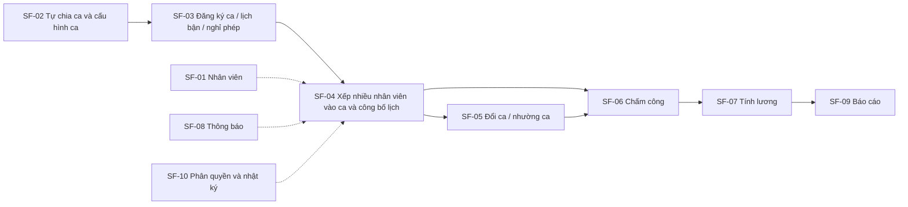
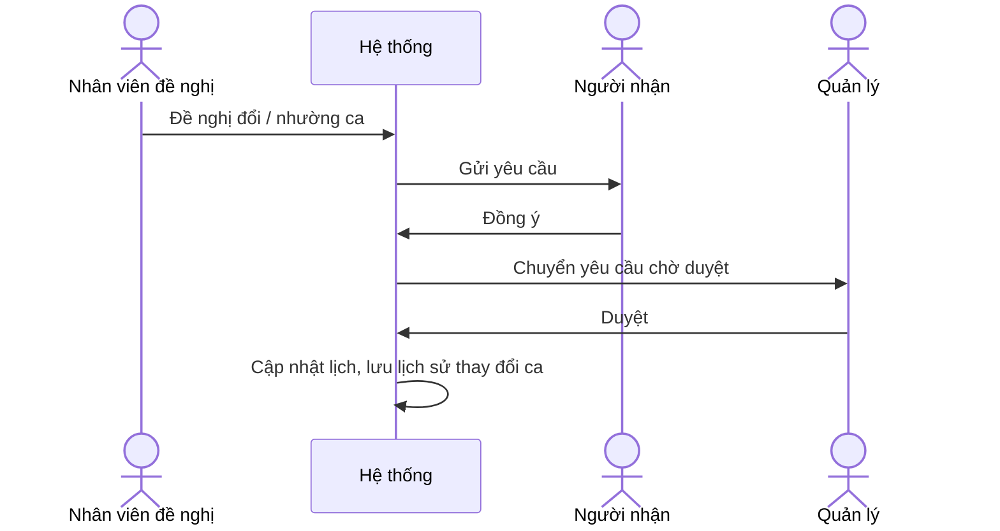

# ĐẶC TẢ YÊU CẦU PHẦN MỀM (SRS)

## Software Requirements Specification

### Hệ thống: Quản lý nhân sự và xếp ca làm cho quán cafe

- **Phiên bản:** v1.1 | **Ngày ban hành:** 09/11/2026
- **Tài liệu tham chiếu:** 02_Tai_lieu_Yeu_cau_Nghiep_vu_BRD.md

---

## 1. GIỚI THIỆU (INTRODUCTION)

### 1.1. Mục đích tài liệu

Tài liệu SRS chi tiết hóa các yêu cầu nghiệp vụ trong BRD thành các đặc tả chức năng phần mềm cho hệ thống quản lý nhân sự và xếp ca của quán cafe.

### 1.2. Phạm vi phần mềm

Hệ thống gồm 10 phân hệ:

1. SF-01: Quản lý nhân viên
2. SF-02: Cấu hình ca làm
3. SF-03: Đăng ký ca và khả năng làm việc
4. SF-04: Xếp ca
5. SF-05: Đổi ca và nhường ca
6. SF-06: Chấm công
7. SF-07: Tính lương và thưởng phạt
8. SF-08: Thông báo
9. SF-09: Báo cáo
10. SF-10: Phân quyền và hệ thống

Phần xử lý order (bán hàng) không thuộc phạm vi.

### 1.3. Định nghĩa

- **Ca làm:** Khoảng thời gian làm việc trong ngày do quản lý tự chia theo mong muốn, có giờ bắt đầu và giờ kết thúc. Một ca có thể có nhiều nhân viên cùng làm.
- **Vị trí:** Công việc của nhân viên trong quán: pha chế, thu ngân, phục vụ, bếp, quản lý.
- **Xếp ca:** Phân công nhân viên vào các ca làm.
- **Công bố lịch:** Bước quản lý chốt và gửi lịch làm cho nhân viên.
- **Đổi ca / nhường ca:** Nhân viên chuyển ca của mình cho người khác hoặc đổi với người khác.
- **MVP:** Phiên bản đầu tiên gồm các chức năng cốt lõi (xem mục 7).

---

## 2. MÔ TẢ TỔNG QUAN HỆ THỐNG

### 2.1. Các vai trò người dùng

- **Chủ quán:** Xem báo cáo giờ làm và chi phí nhân công, phân quyền, xem nhật ký thao tác.
- **Quản lý quán:** Quản lý hồ sơ nhân viên, tự chia ca và cấu hình ca, xếp nhiều nhân viên vào mỗi ca và công bố lịch, duyệt đổi ca, xử lý và chỉnh sửa chấm công, tổng hợp lương.
- **Nhân viên:** Đăng ký ca, khai báo lịch bận, xin nghỉ phép, xem lịch làm, đề nghị đổi/nhường ca, chấm công, nhận thông báo, xem phiếu lương của mình.

### 2.2. Luồng tổng thể

---

## 3. ĐẶC TẢ YÊU CẦU CHỨC NĂNG (FUNCTIONAL REQUIREMENTS)

### 3.1. Phân hệ SF-01: Quản lý nhân viên

- **SF-01.1:** Hệ thống cho phép tạo, xem và cập nhật hồ sơ nhân viên gồm thông tin cá nhân và thông tin liên hệ.
- **SF-01.2:** Hệ thống cho phép chọn loại hợp đồng của nhân viên: full-time, part-time hoặc thời vụ.
- **SF-01.3:** Hệ thống cho phép gán vị trí cho nhân viên: pha chế, thu ngân, phục vụ, bếp, quản lý.
- **SF-01.4:** Hệ thống cho phép lưu mức lương của nhân viên theo giờ hoặc theo ca.
- **SF-01.5:** Hệ thống lưu trạng thái nhân viên: đang làm hoặc nghỉ việc.

### 3.2. Phân hệ SF-02: Cấu hình ca làm

- **SF-02.1:** Hệ thống cho phép quản lý tự tạo, sửa và xóa ca làm theo mong muốn: số lượng ca, tên ca, giờ bắt đầu và giờ kết thúc không bị cố định sẵn (ví dụ: chia thành ca sáng, chiều, tối, hoặc chia theo cách khác).
- **SF-02.2:** Hệ thống cho phép khai báo nhu cầu nhân sự của mỗi ca: một ca có thể có nhiều nhân viên; quản lý khai báo số lượng nhân viên cần và, nếu muốn, số lượng theo từng vị trí (ví dụ: một ca cần 1 pha chế + 2 phục vụ).
- **SF-02.3:** Hệ thống cho phép cấu hình ca và nhu cầu nhân sự khác nhau cho ngày thường, cuối tuần và ngày lễ.

### 3.3. Phân hệ SF-03: Đăng ký ca và khả năng làm việc

- **SF-03.1:** Hệ thống cho phép nhân viên đăng ký các ca muốn làm trong tuần/tháng tới. Nhiều nhân viên có thể đăng ký cùng một ca.
- **SF-03.2:** Hệ thống cho phép nhân viên khai báo lịch bận cố định (ví dụ: bận học vào một số buổi cố định trong tuần).
- **SF-03.3:** Hệ thống cho phép nhân viên gửi yêu cầu xin nghỉ phép.

### 3.4. Phân hệ SF-04: Xếp ca

- **SF-04.1:** Hệ thống cung cấp giao diện lịch để quản lý xếp ca thủ công bằng thao tác kéo thả; có thể xếp nhiều nhân viên vào cùng một ca.
- **SF-04.2:** Hệ thống gợi ý hoặc tự động xếp ca dựa trên đăng ký của nhân viên, nhu cầu nhân sự của ca và các quy tắc xếp ca.
- **SF-04.3:** Hệ thống cảnh báo các xung đột khi xếp ca:
  - Trùng ca (một nhân viên bị xếp vào các ca trùng giờ)
  - Thiếu người so với nhu cầu của ca
  - Vượt giờ làm tối đa
  - Thiếu vị trí cần thiết
- **SF-04.4:** Hệ thống cho phép quản lý công bố lịch và gửi thông báo cho nhân viên.
- **SF-04.5:** Hệ thống hỗ trợ các nhóm quy tắc xếp ca: số giờ làm tối đa mỗi tuần; thời gian nghỉ tối thiểu giữa 2 ca; số người cần cho mỗi ca (tổng và theo từng vị trí); ca mà nhân viên part-time được phép làm. Giá trị cụ thể của từng quy tắc chưa được xác định.

### 3.5. Phân hệ SF-05: Đổi ca và nhường ca

- **SF-05.1:** Hệ thống cho phép nhân viên đề nghị đổi ca hoặc nhờ người khác làm thay.
- **SF-05.2:** Hệ thống cho phép người nhận đồng ý yêu cầu, sau đó quản lý duyệt.
- **SF-05.3:** Hệ thống lưu lịch sử thay đổi ca.

### 3.6. Phân hệ SF-06: Chấm công

- **SF-06.1:** Hệ thống cho phép nhân viên check-in và check-out (qua app, QR tại quán hoặc GPS; phương thức cụ thể chưa chốt).
- **SF-06.2:** Hệ thống xử lý các trường hợp đi trễ, về sớm và quên chấm công.
- **SF-06.3:** Hệ thống cho phép quản lý chỉnh sửa công và ghi lại lý do chỉnh sửa.

### 3.7. Phân hệ SF-07: Tính lương và thưởng phạt

- **SF-07.1:** Hệ thống tổng hợp giờ công theo kỳ.
- **SF-07.2:** Hệ thống ghi nhận phụ cấp, thưởng, phạt, tăng ca và hệ số ngày lễ.
- **SF-07.3:** Hệ thống tạo phiếu lương cho từng nhân viên.
- **SF-07.4:** Hệ thống cho phép xuất dữ liệu lương ra Excel.

### 3.8. Phân hệ SF-08: Thông báo

- **SF-08.1:** Hệ thống nhắc ca sắp tới.
- **SF-08.2:** Hệ thống thông báo khi có lịch mới.
- **SF-08.3:** Hệ thống thông báo kết quả duyệt đổi ca và nghỉ phép.
- **SF-08.4:** Kênh thông báo có thể là push, Zalo hoặc Telegram bot (chưa chốt).

### 3.9. Phân hệ SF-09: Báo cáo

- **SF-09.1:** Báo cáo tổng giờ làm theo nhân viên.
- **SF-09.2:** Báo cáo tỷ lệ đi trễ / vắng.
- **SF-09.3:** Báo cáo chi phí nhân công theo tuần/tháng.
- **SF-09.4:** Báo cáo ca thường thiếu người.

### 3.10. Phân hệ SF-10: Phân quyền và hệ thống

- **SF-10.1:** Hệ thống phân quyền theo vai trò: chủ quán, quản lý, nhân viên.
- **SF-10.2:** Hệ thống ghi nhật ký thao tác: ai sửa lịch, ai sửa công.
- **SF-10.3:** Hỗ trợ đa chi nhánh (để giai đoạn sau).

---

## 4. MÔ HÌNH DỮ LIỆU KHÁI NIỆM

Các nhóm dữ liệu chính suy ra từ các chức năng ở mục 3. Thuộc tính chi tiết sẽ được xác định ở bước thiết kế.

| Nhóm dữ liệu | Nội dung lưu trữ |
|:--|:--|
| Nhân viên | Thông tin cá nhân, thông tin liên hệ, loại hợp đồng, vị trí, mức lương (theo giờ hoặc theo ca), trạng thái (đang làm / nghỉ việc) |
| Định nghĩa ca | Tên ca, giờ bắt đầu, giờ kết thúc (do quản lý tự đặt), số nhân viên cần (tổng và theo vị trí), cấu hình cho ngày thường / cuối tuần / ngày lễ |
| Đăng ký ca và khả năng làm việc | Ca nhân viên muốn làm, lịch bận cố định, yêu cầu nghỉ phép |
| Lịch làm | Phân công nhân viên vào ca (một ca gồm nhiều nhân viên), trạng thái công bố |
| Yêu cầu đổi / nhường ca | Người đề nghị, người nhận, kết quả đồng ý, kết quả duyệt, lịch sử thay đổi |
| Chấm công | Check-in, check-out, đi trễ, về sớm, quên chấm công, lý do chỉnh sửa |
| Lương | Giờ công theo kỳ, phụ cấp, thưởng, phạt, tăng ca, hệ số ngày lễ, phiếu lương |
| Thông báo | Nhắc ca, lịch mới, kết quả duyệt đổi ca và nghỉ phép |
| Nhật ký thao tác | Người sửa lịch, người sửa công |
| Người dùng và vai trò | Vai trò: chủ quán, quản lý, nhân viên |

---

## 5. YÊU CẦU PHI CHỨC NĂNG (NON-FUNCTIONAL REQUIREMENTS)

- **NFR-01 (Phân quyền truy cập):** Quyền sử dụng chức năng được phân theo vai trò chủ quán, quản lý và nhân viên (SF-10.1).
- **NFR-02 (Truy vết):** Hệ thống lưu nhật ký thao tác đối với việc sửa lịch và sửa công (SF-10.2).

---

## 6. MA TRẬN TRUY XUẤT YÊU CẦU (RTM)

| Yêu cầu nghiệp vụ (BRD) | Chức năng phần mềm (SRS) | Giai đoạn |
|:--|:--|:--|
| BR-01 Quản lý nhân viên | SF-01 | MVP |
| BR-02 Cấu hình ca làm (tự chia ca, nhiều nhân viên mỗi ca) | SF-02 | MVP |
| BR-03 Đăng ký ca và khả năng làm việc | SF-03.1 | MVP |
| BR-03 (lịch bận cố định) | SF-03.2 | Chưa xếp giai đoạn |
| BR-03 (nghỉ phép) | SF-03.3 | Giai đoạn 2 |
| BR-04 Xếp ca (thủ công, cảnh báo, công bố) | SF-04.1, SF-04.3, SF-04.4, SF-04.5 | MVP |
| BR-04 (gợi ý / tự động xếp ca) | SF-04.2 | Giai đoạn 3 |
| BR-05 Đổi ca và nhường ca | SF-05 | Giai đoạn 2 |
| BR-06 Chấm công | SF-06 | Giai đoạn 2 |
| BR-07 Tính lương và thưởng phạt | SF-07 | Giai đoạn 3 |
| BR-08 Thông báo | SF-08 | Giai đoạn 2 |
| BR-09 Báo cáo | SF-09 | Giai đoạn 3 |
| BR-10 Phân quyền cơ bản | SF-10.1 | MVP |
| BR-10 Nhật ký thao tác | SF-10.2 | Chưa xếp giai đoạn |
| BR-10 Đa chi nhánh | SF-10.3 | Để sau |

---

## 7. PHÂN KỲ TRIỂN KHAI

- **MVP:** Hồ sơ nhân viên; cấu hình ca (tự chia ca, nhiều nhân viên mỗi ca); đăng ký ca; xếp ca thủ công có cảnh báo xung đột; công bố lịch; phân quyền cơ bản.
- **Giai đoạn 2:** Đổi ca; nghỉ phép; chấm công; thông báo qua Telegram/Zalo.
- **Giai đoạn 3:** Tính lương; báo cáo; tự động gợi ý xếp ca.
- **Để sau:** Quản lý đa chi nhánh.
